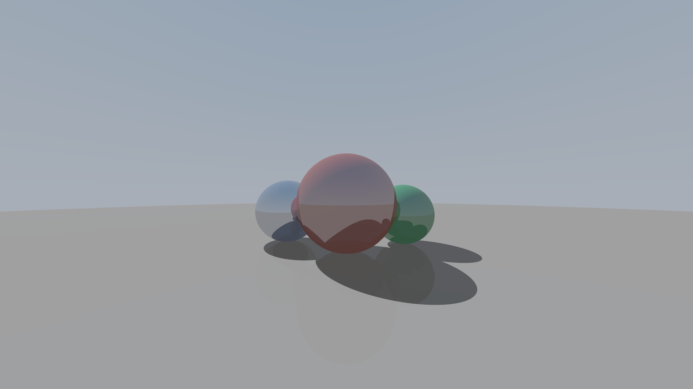

# OpenMP Ray Tracer

A simple CPU-based ray tracer written in C, using OpenMP for parallel rendering. The project implements ray-sphere intersections, diffuse lighting, shadows, reflections, and anti-aliasing without relying on external graphics libraries.

## Render Preview



## Features

- **Ray-Sphere Intersection:** Calculates intersections between rays and spheres using the quadratic equation.
- **Diffuse Lighting:** Implements basic Lambertian diffuse shading.
- **Shadows:** Uses shadow rays to determine whether objects are illuminated by the light source.
- **Reflections:** Supports recursive reflections with configurable reflectivity and maximum ray depth.
- **Anti-Aliasing:** Uses multiple jittered samples per pixel to reduce aliasing.
- **Sky Gradient:** Provides a gradient background based on ray direction.
- **Tone Mapping:** Applies Reinhard tone mapping and gamma correction.
- **Multithreading:** Uses OpenMP to parallelize rendering across CPU threads.
- **Deterministic Sampling:** Uses a lightweight per-pixel random number generator, avoiding shared random state between threads.

## Requirements

- C compiler (GCC or Clang)
- OpenMP support
- Math library (`libm`)

No external graphics libraries are required.

## Compilation

Compile the project using GCC:

```bash
gcc -O3 -march=native -fopenmp raytracer.c -o raytracer -lm
```

## Usage

```bash
./raytracer [width] [height] [samples] [output]
```

| Argument | Description | Default |
|---|---|---|
| `width` | Image width in pixels | 1280 |
| `height` | Image height in pixels | 720 |
| `samples` | Samples per pixel | 16 |
| `output` | Output image filename | render.ppm |

### Examples

Render a 1280 × 720 image with 16 samples per pixel:

```bash
./raytracer
```

Render a 1920 × 1080 image with 32 samples per pixel:

```bash
./raytracer 1920 1080 32 render.ppm
```

Render a 4K image with 16 samples per pixel:

```bash
./raytracer 3840 2160 16 render.ppm
```

The output is stored in binary PPM (P6) format. You can convert it to PNG using ImageMagick:

```bash
magick render.ppm output.png
```

## OpenMP Configuration

The renderer parallelizes image generation using an OpenMP parallel loop.

```c
#pragma omp parallel for schedule(dynamic, 1)
```

Each thread processes independent image rows, and each pixel is calculated independently. This avoids shared pixel access and synchronization overhead during rendering.

You can control the number of OpenMP threads using:

```bash
OMP_NUM_THREADS=8 ./raytracer 1920 1080 16 render.ppm
```

The program also reports the number of available OpenMP threads and the rendering time.

## Configuration

Several rendering parameters can be adjusted directly in the source code:

| Parameter | Description | Default |
|---|---|---|
| `MAX_DEPTH` | Maximum recursive reflection depth | 4 |
| `EPSILON` | Ray intersection offset | 0.0001 |
| `MAX_SPHERES` | Defined sphere limit (currently unused) | 8 |
| `LIGHT_DIRECTION` | Direction of the light source | `{-0.6, 1.0, -0.7}` |

Sphere positions, radii, colors, and reflectivity values can also be modified in the `spheres` array.

## Technologies

- C
- OpenMP
- CPU Multithreading
- Ray Tracing
- Computer Graphics

## License

This project is open-source. Feel free to explore, modify, and experiment with the implementation.
